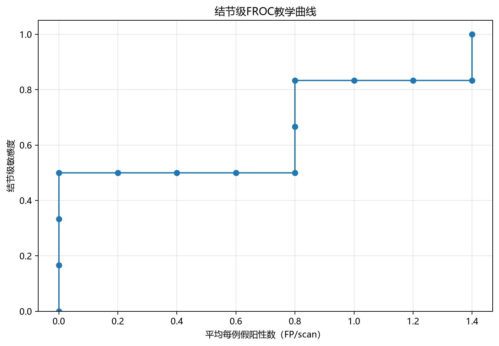

# 肺结节 AI 辅助阅片验证与模拟分析

`lung-nodule-reader-study-demo` 是一个文档驱动、可复现的临床验证模拟分析项目，以小型 Python 教学流程回答：AI 辅助阅片是否改变检出能力、误报负担和阅片时间？如何组织配对数据、核对指标，并解释不确定性？

这里没有训练模型，也没有接入真实 AI 产品。所有样例均由程序生成，不能作为真实产品临床有效性、临床获益或注册证据。

## 项目概览

- 设计：8 名虚构阅片者、80 例虚构 CT、无 AI/AI 辅助两条件，共 1280 条配对阅片记录；AB/BA 序列按独立种子平衡分配。
- 分析：23 项数据质控、阅片者指标与配对差值、基于预设匹配关系的 FROC、阅片者与病例双向重抽样的教学推断。
- 工程：一条命令运行、独立输出目录、失败即停、参数/环境/文件哈希记录、关键公式与异常输入测试。
- 分析链条：从临床问题出发，连接数据规则、分析代码、结果复核和解释边界。

先看[临床验证方案](docs/肺结节AI辅助阅片临床验证方案.pdf)了解研究设计，再看[模拟结果说明](04_分析结果/模拟结果说明.md)、[运行说明](docs/running.md)与[验证结果](docs/validation.md)。

方案共 23 页，包含 V2.0 教学研究设计、模拟结果、参考资料和代码说明。附件 C 为当前文件清单，附件 D 介绍安装运行、软件验证及实现边界；方案与代码的对应关系见[配套说明](docs/protocol-code-amendment.md)。

## 模拟结果示例

以下为固定默认种子下的阅片者平均值；差异方向均为“AI 辅助 − 无 AI”。

| 指标 | 无 AI | AI 辅助 | 描述性差异 |
|---|---:|---:|---:|
| 结节级敏感度 | 77.46% | 83.71% | +6.25 个百分点 |
| FP/scan | 0.506 | 0.680 | +0.173 |
| 阅片时间（分钟/病例） | 4.824 | 4.123 | −0.701 |

敏感度差异的教学性 95% 区间为 −1.44～14.12 个百分点，包含 0。模拟中的时间缩短伴随误报增加，不能只用一个指标评价效果。完整结果见[教学推断说明](04_分析结果/MRMC教学性推断结果说明.md)。



图中 FROC 使用另一个小型示例：5 例扫描、6 个参考结节、13 个候选。它不是上方 80 例阅片实验的性能曲线，也不执行真实影像坐标匹配。

## 安装与运行

实测环境：Windows x64 / Python 3.14.5。其他系统与 Python 版本尚未验收；范围依赖不代表所有组合均可运行。以下命令在项目根目录执行，`python` 需指向已安装的实际解释器。

```powershell
python -m venv .venv
.\.venv\Scripts\python.exe -m pip install -r requirements-lock-windows-py314.txt
.\.venv\Scripts\python.exe -m pip check
.\.venv\Scripts\python.exe run_all.py
```

最后一条命令默认执行 5000 次 bootstrap，自动新建 `outputs/run-时间戳/`。也可指定尚不存在的目录：

```powershell
.\.venv\Scripts\python.exe run_all.py --output outputs/demo
.\.venv\Scripts\python.exe -m unittest discover -s tests -t . -v
```

一次运行生成 7 份模拟 CSV、7 份结果 CSV、2 份说明、6 张 PNG、1 份 Excel，以及日志和 `run_manifest.json`。不会覆盖预计算样例。已有输出目录会被拒绝，即使目录为空；再次运行请换名称，或省略 `--output`。

图表默认检测中文字体；无合适字体时回退英文。可用 `--plot-language en` 强制英文，CSV 与报告仍保留原内容。参数、失败定位和历史脚本的覆盖风险见[运行说明](docs/running.md)。此入口不能导入患者数据。

`requirements-verified.txt` 固定四个直接依赖；`requirements-lock-windows-py314.txt` 固定实测运行依赖及其间接依赖；`requirements.txt` 提供范围依赖。标准库 unittest 不另装测试框架。

## 文件与分析链条

```text
lung-nodule-reader-study-demo/
├─ run_all.py                  # 统一入口与运行记录
├─ requirements*.txt           # 运行依赖与实测版本
├─ 02_统计分析代码/            # 四步脚本、配置与字体模块
├─ 03_模拟数据/                # 7 份预计算输入及数据字典
├─ 04_分析结果/                # 7 份结果 CSV、2 份说明、6 张图
├─ tests/                      # 关键逻辑与运行保护测试
├─ docs/                       # 方案 PDF、运行、验证与方案代码配套说明
├─ CHANGELOG.md
└─ .gitignore
```

| 脚本 | 做什么 |
|---|---|
| `01_generate_mrmc_simulation.py` | 按固定种子生成阅片配对数据和小型 FROC 示例 |
| `02_mrmc_descriptive.py` | 数据质控、阅片者指标、AI 辅助减无 AI 的配对差值与图表 |
| `03_lesion_level_froc.py` | 阈值筛选、按预设参考 ID 计 TP、重复检出计 FP、FROC |
| `04_mrmc_inference_teaching.py` | 保持条件配对的双向 bootstrap、区间与探索性 P 值、Excel |

逐条输入字段见[数据字典](03_模拟数据/data_dictionary.csv)。病例级阳性采用教学规则 `TP + FP > 0`；AB/BA 仅建立两周期结构，当前不估计周期或携带效应。

## 验证与局限

当前包含 62 个 unittest 测试方法。Windows / Python 3.14.5 验证结果为 61 个通过、1 个因符号链接权限跳过，无失败或错误。默认 5000 次分析与“2 次、种子 0”的边界调试流程均成功，各 23 项数据质控通过；默认 14 份 CSV 与预计算样例字节一致。低次数重抽样仅用于调试，不能用于统计解释。测试覆盖、环境范围及历史环境验证见[验证结果](docs/validation.md)。未执行 GitHub Actions，未验证其他平台。

这是教学性推断：同时重抽阅片者和病例，保留两条件配对；区间采用 percentile bootstrap。探索性 P 值用“差异 / bootstrap 标准误”的双侧正态近似，不是在零假设下构造的 bootstrap 检验，不能替代正式 MRMC 主分析。代码不包括真实影像、空间匹配、模型推理、样本量论证或真实多中心验证。

综合 Excel 由统一入口生成，位于新运行目录的 `workbooks/`，不作为预计算附件提供。FROC 的无穷大阈值在工作簿中保存为文本 `inf`。

## 关键方法说明

同一阅片者对同一病例有两种条件的结果，1280 行记录不能当作 1280 个独立病例。重抽样同时抽取阅片者和病例，并保留两条件配对权重；这不等同于经验证的正式 MRMC 分析。

结节级敏感度按每名阅片者的 TP 总数除以参考结节总数计算，FP/scan 按 FP 总数除以扫描数计算，再汇总阅片者指标。FROC 按预设参考 ID 计独特检出：同一参考结节仅计一个 TP，重复候选的其他检出计为 FP。代码不执行真实影像空间匹配。

## 来源与 AI 工具参与

项目基于 V2.0 教学方案整理。AI 工具参与资料整理、方案与代码初稿、文字润色、测试、运行入口及环境适配；本项目不声称全部代码均由作者独立编写。

本项目侧重临床问题到可复现分析的衔接，不提出新的 MRMC 或 FROC 算法。外部资料出处见方案参考文献；仓库不附带外部论文或监管文件全文。参考资料用于教学背景，不构成现行监管要求的完整核验或医学建议。
